# Órbita Zero

**Shooter espacial vertical para móvil, hecho sobre mi propio motor de juegos 2D.**
Sin dependencias, sin imágenes y sin audio: todo se genera con código.

Autor: **Diego Fernández Ortega**

**DiegoFo Engine** es un motor de juegos 2D propio, escrito en JavaScript, pensado para móviles y sin dependencias. Con él he hecho **Órbita Zero**, un *shoot 'em up* vertical completo:
- **La partida:** tu nave dispara sola, tú la mueves arrastrando el dedo, resistes oleadas de enemigos y cada 5 oleadas te enfrentas a un **jefe** (Acorazado, Enjambre o Leviatán) con tres fases de ataque. Después de cada jefe entras en un **sector** nuevo de la galaxia.
- **El progreso:** **pilotos**, **créditos**, un **hangar** con mejoras permanentes y pinturas, **16 logros**, **estadísticas con historial**, **copia de seguridad** y **música generada**.
- **Como app:** se instala en el móvil y funciona sin conexión.

El juego se dibuja con el motor en un `<canvas>`. Toda la interfaz usa **[diegofo-ui](https://github.com/DiegoFdzOrtega/diegofo-ui)**, mi librería de Web Components: menús, marcador, barras de vida, hangar, logros, tablas de estadísticas, formularios y avisos.

<p align="center"><a href="https://diegofdzortega.github.io/orbita-zero/"><strong>▶ Jugar online</strong></a> · se puede instalar en el móvil como una app</p>

<p align="center">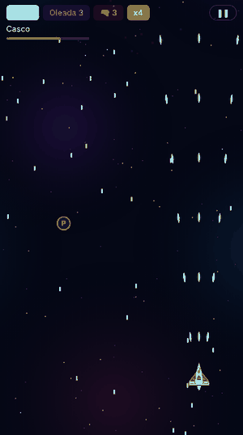</p>

| Menú | Acorazado | Enjambre | Leviatán |
|:---:|:---:|:---:|:---:|
| 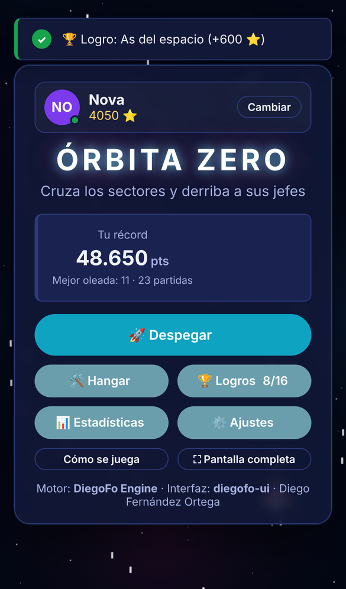 | 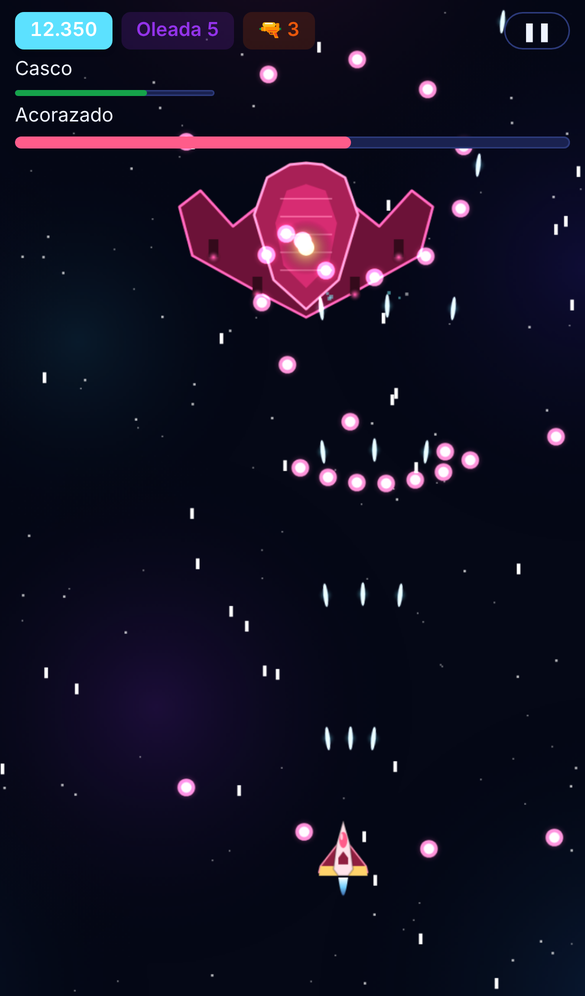 | 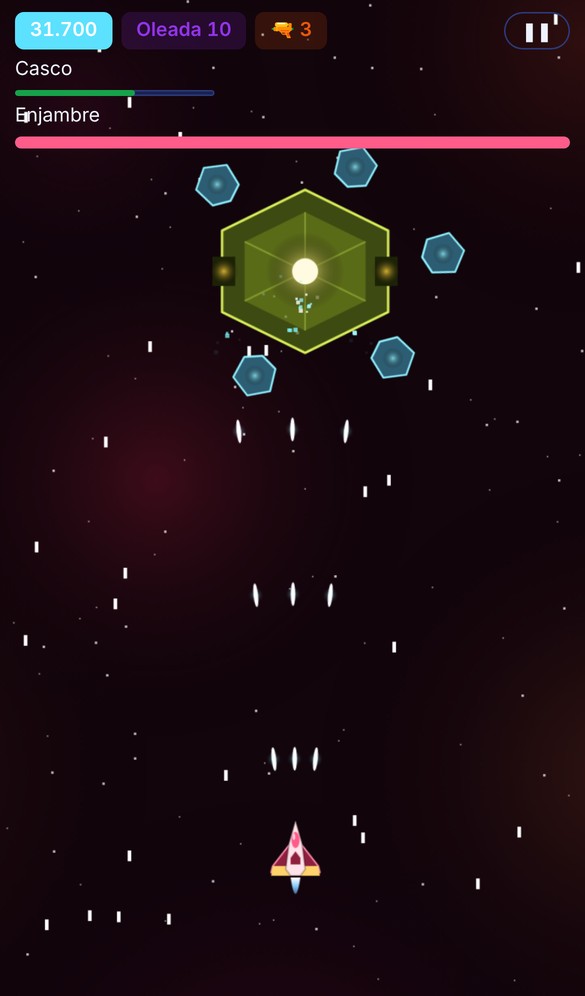 | 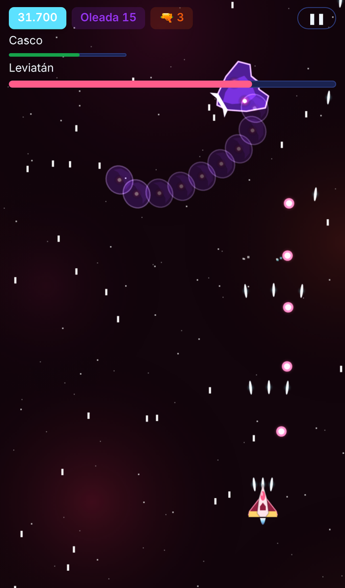 |

| Nuevo sector | Hangar | Logros |
|:---:|:---:|:---:|
| 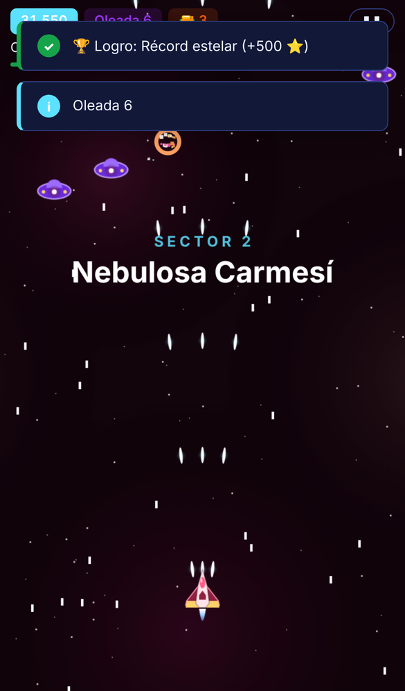 | 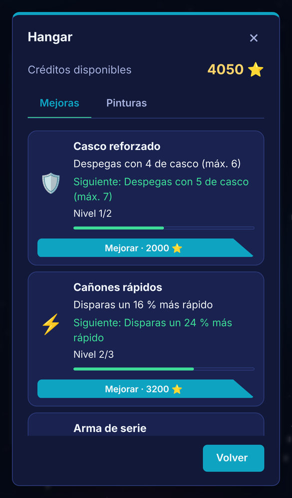 | 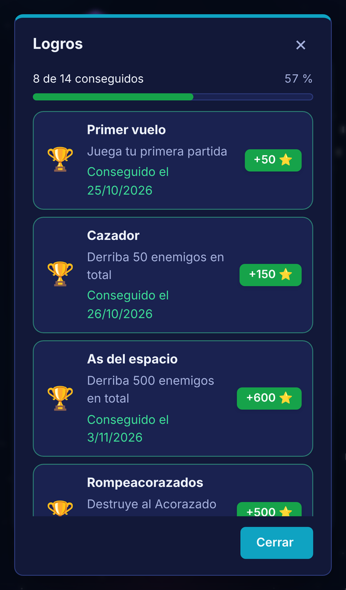 |

---

## Índice

1. [Cómo ejecutarlo](#cómo-ejecutarlo)
2. [Estructura del proyecto](#estructura-del-proyecto)
3. [Integración con Desarrollo de Interfaces](#integración-con-desarrollo-de-interfaces)
4. [Progreso del jugador: pilotos, hangar, logros y estadísticas](#progreso-del-jugador-pilotos-hangar-logros-y-estadísticas)
5. [a) Arquitectura de un juego 2D y 3D](#a-arquitectura-de-un-juego-2d-y-3d)
6. [b) Componentes de un motor de juegos](#b-componentes-de-un-motor-de-juegos)
7. [c) Entornos de desarrollo de juegos](#c-entornos-de-desarrollo-de-juegos)
8. [d) Comparativa de motores de juegos](#d-comparativa-de-motores-de-juegos)
9. [e) Bloques funcionales de un juego existente](#e-bloques-funcionales-de-un-juego-existente)
10. [f) Representación lógica y espacial de una escena](#f-representación-lógica-y-espacial-de-una-escena)
11. [Pruebas](#pruebas)
12. [Cómo hacer un juego con DiegoFo Engine](#cómo-hacer-un-juego-con-diegofo-engine)
13. [Créditos](#créditos)

---

## Cómo ejecutarlo

1. Abre `index.html` con doble clic. No hace falta instalar nada, ni servidor, ni conexión a internet.
2. Para ver la parte 3D, abre `ejemplos/escena-3d.html`.
3. Para jugar en el móvil, sube la carpeta a GitHub Pages y abre el enlace. Se puede añadir a la pantalla de inicio como una app.

**Controles**

| | Móvil | Teclado |
|---|---|---|
| Mover la nave | Arrastrar el dedo por cualquier parte (movimiento relativo: el dedo no tapa la nave) | Flechas o `W` `A` `S` `D` |
| Disparar | Automático | Automático |
| Pausa | Botón ❚❚ | `P` o `Esc` |
| Depurador | Ajustes → *Modo depuración* | `F2` |

**Enemigos y mejoras**

| Enemigo | Comportamiento |
|---|---|
| **Dron** | Baja haciendo eses. Llega en filas, en uve o en serpiente |
| **Caza** | Entra, se para y dispara ráfagas de 3 balas hacia ti. A los 6 s se marcha |
| **Kamikaze** | Baja despacio, fija tu posición y se lanza acelerando |
| **Fragata** | Grande y lenta. Dispara anillos de 10 balas que giran |

**Jefes** (uno cada 5 oleadas; se turnan y en cada vuelta tienen más vida). Todos tienen 3 fases según la vida que les queda y atacan más rápido en cada fase:

| Jefe | Oleadas | Cómo se derrota |
|---|---|---|
| **Acorazado** | 5, 20, 35… | Fase 1: abanicos apuntados. Fase 2: + espiral desde el núcleo. Fase 3: + anillos desde las alas |
| **Enjambre** | 10, 25, 40… | Nave nodriza rodeada por un **escudo de 6 placas que giran**. Mientras quede una placa, el núcleo es invulnerable, y si las rompes todas se regeneran a los 9 s. Fabrica drones y, desde la fase 2, kamikazes |
| **Leviatán** | 15, 30, 45… | **Serpiente de 9 segmentos** que recorre la pantalla dibujando un 8. Cada segmento dispara por su cuenta. La **cabeza recibe el doble de daño**: es el punto débil |

**Sectores:** cada 5 oleadas se entra en uno nuevo, con un rótulo grande y un fundido de la nebulosa: **1 · Nebulosa Índigo**, **2 · Nebulosa Carmesí**, **3 · Cinturón Esmeralda** y **4 · Vacío Dorado**. Después se repiten.

Mejoras que sueltan los enemigos: **P** (sube el arma hasta 5 disparos), **S** (escudo de 10 s que aguanta un golpe) y **+** (repara el casco). Cada golpe recibido baja un nivel de arma.

**Combo:** cada 4 derribos seguidos (sin dejar pasar 1,5 s) el multiplicador de puntos sube un punto, hasta **x5**. Recibir un golpe lo reinicia.

---

## Estructura del proyecto

```
RA4-Multimedia/
├── index.html               ← el juego: canvas + interfaz con diegofo-ui
├── manifest.webmanifest     ← para instalarlo como app (pantalla completa, vertical)
├── sw.js                    ← service worker: funciona sin conexión
├── iconos/                  ← icono de la app
├── lib/
│   └── diegofo-ui.min.js    ← librería de componentes (RA3 de Interfaces)
├── motor/                   ← DiegoFo Engine (reutilizable en cualquier juego)
│   ├── nucleo.js            ← espacio de nombres DFE, utilidades y eventos
│   ├── pantalla.js          ← render: canvas, escalado a cada pantalla y cámara
│   ├── nodo.js              ← grafo de escena: Nodo, Escena, Sprite, Texto, CapaRepetida
│   ├── entrada.js           ← teclado + ratón + táctil en acciones con nombre
│   ├── fisica.js            ← gravedad, velocidad y colisiones AABB
│   ├── audio.js             ← sonidos sintetizados, secuenciador de música (Web Audio) y vibración
│   ├── recursos.js          ← carga de recursos con progreso y texturas generadas
│   ├── particulas.js        ← sistema de partículas
│   ├── guardado.js          ← récord y ajustes en el dispositivo
│   ├── depurador.js         ← FPS, árbol de la escena y cajas de colisión
│   ├── ui.js                ← puente con diegofo-ui
│   └── motor.js             ← bucle de juego y gestión de escenas
├── juego/                   ← Órbita Zero (usa el motor)
│   ├── progreso.js          ← pilotos, créditos, hangar, logros, estadísticas, copia de seguridad
│   ├── arte.js              ← todas las naves, balas y fondos dibujados con código
│   ├── entidades.js         ← Nave, balas, Dron, Caza, Kamikaze, Fragata, Jefe, Mejora…
│   ├── escena-batalla.js    ← árbol de la escena, oleadas, colisiones y reglas
│   └── main.js              ← arranque y conexión motor ↔ interfaz
├── ejemplos/
│   └── escena-3d.html       ← la tubería 3D paso a paso, con el mismo motor
├── pruebas/
│   └── prueba-juego.js      ← pruebas automáticas con Playwright
└── capturas/
```

El **motor** (`motor/`) no sabe nada del juego, y el **juego** (`juego/`) solo usa lo que le ofrece el motor. La misma separación que hay entre Unity y un proyecto hecho con Unity. Antes de Órbita Zero, el motor movía un juego de correr y saltar (*endless runner*) sin cambiar ni una línea del motor. Solo hubo que añadir dos propiedades a `Sprite`: `mezcla` (brillos) y `destello` (parpadeo al recibir daño).

---

## Integración con Desarrollo de Interfaces

El canvas es muy rápido para dibujar 60 veces por segundo, pero no es accesible: un lector de pantalla no puede leer un botón dibujado en él. Por eso el juego se dibuja en el canvas y la interfaz se hace con componentes HTML de **diegofo-ui**, que ya tienen el foco, el teclado y los atributos ARIA resueltos. Los motores profesionales también separan el mundo del juego de la UI (Unity tiene *UI Toolkit* y Godot los nodos *Control*).

Órbita Zero usa **13 de los 15 componentes** de la librería:

| Componente de diegofo-ui | Dónde se usa en el juego |
|---|---|
| `<df-progress>` | Barra de carga, **casco** de la nave (de verde a rojo), **vida del jefe** (con su nombre), niveles del hangar y progreso de cada logro |
| `<df-button>` | Todos los botones: menú, hangar (comprar), pilotos, pausa, fin de partida… |
| `<df-stat-card>` | Récord del menú, resumen del fin de partida y las 9 tarjetas de estadísticas |
| `<df-badge>` | Marcador (puntos, oleada, arma, **combo**), precios y recompensas de logros |
| `<df-avatar>` | Piloto activo en el menú y lista de pilotos (iniciales y color calculados del nombre) |
| `<df-modal>` | Pausa, fin, pilotos, hangar, logros, estadísticas, ajustes y ayuda |
| `DfModal.prompt` + `<df-input>` | Formulario para **crear un piloto**, con validación |
| `DfModal.confirm` | Confirmar antes de **borrar un piloto** |
| `<df-data-table>` | **Historial de partidas**: se puede ordenar por cualquier columna y tiene paginación |
| `<df-tabs>` + `<df-tab-panel>` | Hangar (Mejoras / Pinturas), Estadísticas (Resumen / Historial / Copia) y Ayuda |
| `<df-switch>` | Efectos de sonido, música, vibración y modo depuración |
| `<df-select>` | Dificultad (Tranquila, Normal, Difícil) |
| `<df-toast-stack>` | Aviso del jefe, oleadas, mejoras, compras y logros desbloqueados |

**Tema:** los componentes leen variables CSS (`--bg-card`, `--text-main`, `--df-color-primary`…). Redefiniéndolas en `index.html`, toda la librería pasa a un tema espacial cian y rosa sin tocar su código.

**Puente motor ↔ interfaz** (`motor/ui.js` y `juego/main.js`):

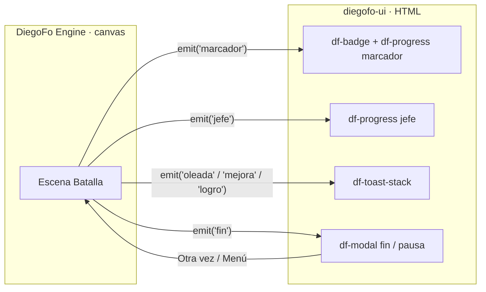

El motor **emite eventos** y la interfaz los escucha. Ninguno depende del otro, y si diegofo-ui no se carga, `DFE.UI` usa las alternativas del navegador.

**Pensado para móvil:** el marcador solo toca el DOM cuando cambia un valor, porque escribir en el DOM 60 veces por segundo gasta batería. El HUD tiene `pointer-events: none` (salvo el botón de pausa), así que los toques lo atraviesan y llegan al juego.

---

## Progreso del jugador: pilotos, hangar, logros y estadísticas

Un juego de móvil tiene que dar motivos para volver. Todo esto vive en `juego/progreso.js`, una clase con **lógica pura** que no toca ni el DOM ni el canvas. La interfaz la usa desde `main.js` y la partida recibe de ella su configuración.

| Sistema | Cómo funciona |
|---|---|
| **Pilotos** | Varios perfiles en el mismo dispositivo. Al abrir el juego por primera vez se pide un nombre (validado: de 2 a 14 caracteres, sin repetir). Se pueden cambiar o borrar (con confirmación) |
| **Créditos ⭐** | 1 por cada 20 puntos + 250 por cada jefe derrotado + las recompensas de los logros. Si abandonas desde la pausa, también se guardan los créditos ganados hasta ese momento |
| **Hangar: mejoras** | 5 mejoras permanentes con varios niveles: casco, cadencia, arma inicial, escudo inicial e **imán** de mejoras. Cambian la partida de verdad: `progreso.configuracionPartida()` → `new EscenaBatalla(..., config)` → `new Nave(config)` |
| **Hangar: pinturas** | 4 colores de nave. Cada pintura se genera como textura propia al cargar el juego |
| **Logros** | 16 retos con barra de progreso y recompensa. Se comprueban **durante la partida** (una vez por segundo) y avisan al momento |
| **Estadísticas** | Partidas, derribos, jefes, mejor puntuación, oleada, sector y combo, tiempo de vuelo… y el historial de las últimas 30 partidas |
| **Copia de seguridad** | Exporta el progreso a un `.json` y lo importa en otro dispositivo. Al importar se **valida y se repara** cada piloto (`_completar`): un archivo manipulado no puede dejar créditos negativos ni niveles imposibles |

| Hangar (pinturas) | Estadísticas | Historial |
|:---:|:---:|:---:|
| 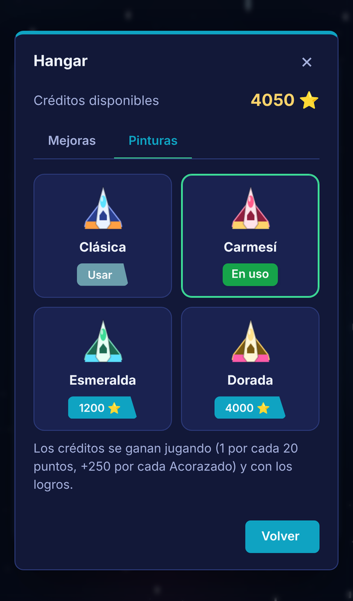 | 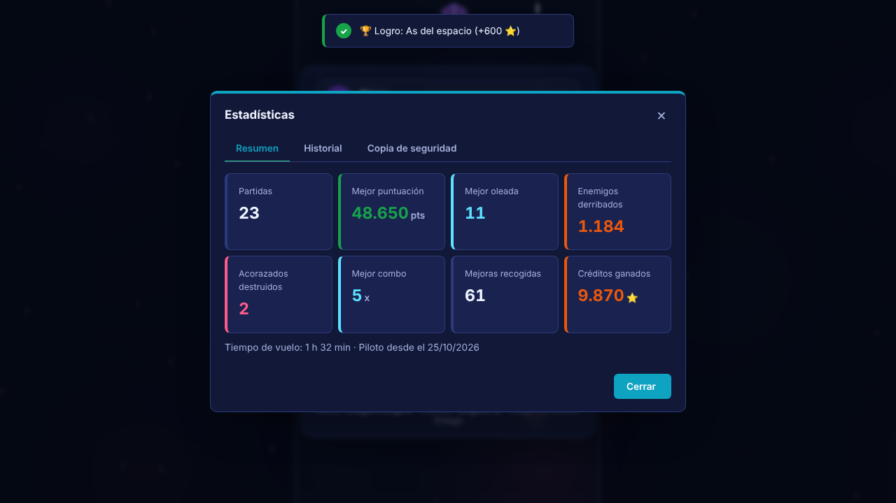 | 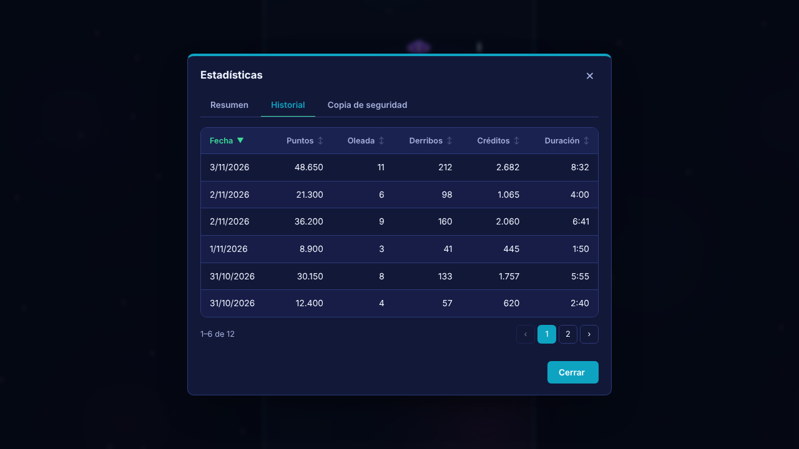 |

### ¿Por qué no hay login con usuario y contraseña?

Un login de verdad necesita un **servidor** que guarde las cuentas. Órbita Zero es una **web estática**: se abre con doble clic, se publica gratis en GitHub Pages y funciona **sin conexión**. Por eso el progreso se guarda **en el dispositivo** (`localStorage`), con perfiles locales y copia de seguridad para llevarlo a otro móvil, como hacen muchos juegos móviles que no tienen cuentas.

Cómo se ampliaría a la nube, sin cambiar la interfaz, porque `Progreso` ya separa la lógica del almacenamiento:
- **API propia en PHP + MySQL** (como mi ERP Crimson): `POST /login`, `GET/PUT /progreso`. `Progreso.guardar()` enviaría el JSON que hoy produce `exportar()`.
- **Firebase Authentication + Firestore**: sirve en GitHub Pages sin servidor propio.

### App instalable y sin conexión (PWA)

- `manifest.webmanifest`: nombre, icono, pantalla completa y orientación vertical. Desde el navegador del móvil se puede **añadir a la pantalla de inicio** y se abre como una app.
- `sw.js` (*service worker*): la primera vez guarda todos los archivos en la caché. Después el juego **abre al instante y funciona en modo avión**. Solo se activa al servirlo por `https` (GitHub Pages); con doble clic no hace falta.

### Música generada con código

El motor incluye un **secuenciador** (`audio.reproducirMusica`). Una canción es una lista de pistas con notas MIDI por semicorchea, y las notas se programan por adelantado con el reloj de la Web Audio API, que es mucho más preciso que `setTimeout`. Órbita Zero tiene tres temas, todos con la progresión *La m – Fa – Do – Sol*:
- **Menú:** tranquilo, a 84 BPM.
- **Batalla:** bombo, bajo y arpegio, a 116 BPM.
- **Jefe:** la de batalla, más rápida (132 BPM).

No hay ni un archivo de audio.

---

## a) Arquitectura de un juego 2D y 3D

Un juego se organiza en **capas**: el juego concreto se apoya en el motor, el motor en las APIs de la plataforma y estas en el hardware.

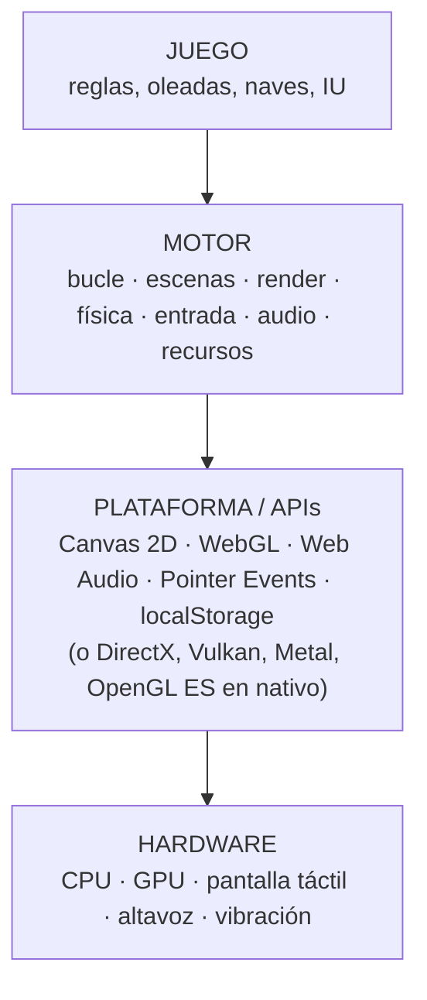

### Elementos comunes

| Elemento | Qué es | En Órbita Zero |
|---|---|---|
| **Bucle de juego** | Repite sin parar: leer entrada → actualizar → dibujar | `Motor._bucle` |
| **Escena / nivel** | Todo lo que existe en un momento del juego | `EscenaBatalla` (y la del menú) |
| **Entidades / actores** | Los objetos del juego, con datos y comportamiento | `Nave`, `Dron`, `Caza`, `Kamikaze`, `Fragata`, `Jefe`, balas, mejoras |
| **Grafo de escena** | Árbol que organiza las entidades (padre → hijos) | `Escena → Mundo → Enemigos → Caza…`, `Nave → Llama, Escudo` |
| **Cámara** | Qué parte del mundo se ve | Centra el campo de 360 unidades y tiembla con las explosiones |
| **Render** | Dibuja la escena en la pantalla | `Pantalla` + Canvas 2D, con mezcla aditiva para los brillos |
| **Física y colisiones** | Movimiento y choques | Cajas AABB: balas ↔ naves, nave ↔ mejoras |
| **Entrada** | Teclado, ratón, táctil, mando | `Entrada` con acciones + arrastre relativo |
| **Audio** | Efectos y música | `Audio` (Web Audio): láser, explosiones, alarma del jefe |
| **Recursos** | Imágenes, sonidos, fuentes… | 14 texturas generadas al cargar |
| **IA / comportamiento** | Cómo actúan los enemigos | `comportamiento()` de cada enemigo; 3 jefes con 3 fases cada uno |
| **Diseño de niveles** | Qué aparece y cuándo | `construirOleada()`: formaciones según la oleada; jefes y sectores cada 5 oleadas |
| **Interfaz (HUD/menús)** | Marcador, menús, diálogos | diegofo-ui |
| **Estado y guardado** | Puntuación, récord, ajustes, progreso | `Guardado` + `Progreso` (pilotos, hangar, logros) |
| **Meta-juego** | Lo que te hace volver | Créditos, hangar, logros y estadísticas |

### Diferencias entre 2D y 3D

| Aspecto | Juego 2D | Juego 3D |
|---|---|---|
| Coordenadas | (x, y) | (x, y, z) |
| Objetos gráficos | **Sprites**: imágenes planas, hojas de sprites | **Mallas**: vértices y triángulos, con texturas y materiales |
| Cámara | **Ortográfica**: el tamaño no cambia con la distancia | **Perspectiva**: lo lejano se ve más pequeño (campo de visión, planos de recorte) |
| Profundidad | Orden de capas (`z`) y **parallax** para simular distancia | **Z-buffer** en la GPU: cada píxel guarda su profundidad |
| Transformaciones | Posición, rotación (un ángulo) y escala | **Matrices 4×4**: modelo → mundo → vista → proyección |
| Iluminación | Normalmente pintada en el dibujo | Luces, normales, sombras y *shaders* |
| Colisiones | Rectángulos (AABB) y círculos | Cajas, esferas, cápsulas y mallas de colisión |
| Render | CPU o GPU (Canvas 2D, WebGL) | Casi siempre GPU (WebGL/WebGPU, Vulkan, Metal, DirectX) |
| Coste en móvil | Bajo | Alto: GPU, batería y calor |

### La tubería 3D, en un ejemplo

En `ejemplos/escena-3d.html` hago a mano, con el mismo motor, lo que en un motor 3D hace la GPU: un cubo pasa por **modelo → mundo → cámara → proyección → pantalla**, se descartan las caras que miran hacia atrás (*back-face culling*), se ordenan por profundidad (algoritmo del pintor) y se iluminan según su ángulo con la luz (Lambert). Arrastrando se gira la cámara, y un panel muestra las coordenadas del vértice más cercano en cada paso.

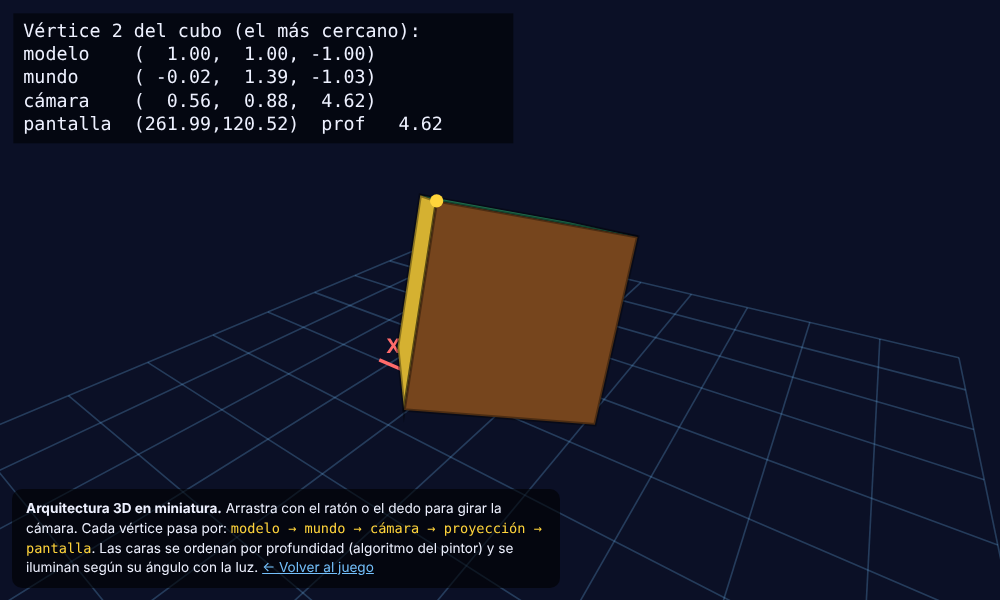

---

## b) Componentes de un motor de juegos

| Componente | Función | En DiegoFo Engine |
|---|---|---|
| **Bucle principal** | Mantiene el juego en marcha y controla el tiempo | `motor.js`: `requestAnimationFrame` + **paso fijo de 1/60 s** |
| **Gestor de escenas** | Cambia entre menú, partida, etc. | `motor.cambiarEscena()`, ganchos `alEntrar` / `alSalir` / `alRedimensionar` |
| **Grafo de escena** | Organiza los objetos en árbol con transformaciones heredadas | `nodo.js`: `Nodo`, `agregar`, `buscar`, `buscarPorEtiqueta` |
| **Motor de render** | Dibuja la escena | `pantalla.js` (Canvas 2D, densidad de píxeles) + `Sprite` (con `mezcla` y `destello`), `Texto`, `CapaRepetida` |
| **Cámara** | Decide qué se ve; seguimiento, límites, temblor | `Camara` en `pantalla.js` |
| **Física** | Movimiento, gravedad | `fisica.js`: integración de Euler |
| **Detección de colisiones** | Saber qué choca con qué | `Fisica.solapan`, `Fisica.comprobar` (AABB por etiquetas) |
| **Entrada** | Leer dispositivos y traducirlos a acciones | `entrada.js` con Pointer Events |
| **Audio** | Efectos y música | `audio.js`: osciladores, ruido y un **secuenciador** de música con Web Audio |
| **Gestor de recursos** | Cargar antes de jugar, con progreso | `recursos.js` + `<df-progress>` |
| **Animación** | Hojas de sprites, animación por código | `Sprite` (columnas, fps); llama del motor, mejoras que laten |
| **Partículas** | Chispas, explosiones… | `particulas.js` con límite de memoria |
| **Persistencia** | Guardar datos | `guardado.js` (localStorage seguro) + `Progreso` en el juego |
| **Eventos / mensajes** | Comunicar piezas sin acoplarlas | `DFE.Emisor` (`on`, `emit`) |
| **Herramientas de depuración** | Ver lo invisible | `depurador.js` (F2) |
| **Interfaz de usuario** | Menús y HUD | `ui.js` → diegofo-ui |

### El bucle de juego con paso fijo

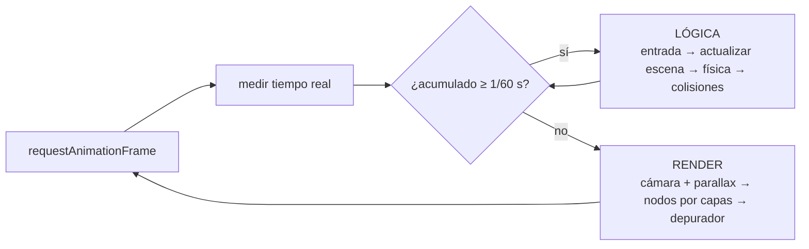

La lógica avanza siempre en trozos de **1/60 s**, aunque el móvil vaya a 30 FPS o la pantalla sea de 120 Hz. Así las balas van a la misma velocidad y el juego es igual de difícil en todos los dispositivos. Además:
- **Límite de 0,25 s por fotograma:** si el móvil se cuelga un momento, no intenta recuperar todo el tiempo de golpe (la llamada *espiral de la muerte*).
- **`escalaTiempo`:** permite la cámara lenta cuando explota tu nave.
- **Pausa automática** con `visibilitychange` al cambiar de app o bloquear el móvil. También se suspende el audio.

### Decisiones pensadas para móvil

| Problema del móvil | Solución en el motor / juego |
|---|---|
| Pantallas de todos los tamaños y orientaciones | Resolución lógica mínima de **360 × 600 unidades**. El campo de juego mide siempre 360 de ancho y, en pantallas anchas, queda centrado con los lados oscurecidos |
| Densidad de 3× o 4× | Se limita a 2×: casi no se nota y ahorra mucha GPU y batería |
| El dedo tapa lo que tocas | **Movimiento relativo**: la nave se desplaza lo mismo que el dedo, toques donde toques |
| No hay botón de disparo cómodo | **Disparo automático** |
| El navegador hace scroll o zoom al tocar | `touch-action: none` y `overscroll-behavior: none` |
| El audio necesita un gesto del usuario | `audio.desbloquear()` en el primer toque |
| Memoria limitada | Las balas y naves que salen del campo se destruyen; las balas enemigas tienen un máximo (260) y las partículas también |
| Los efectos de brillo (`shadowBlur`) son lentos | El brillo va **"horneado"** en las texturas, que se generan una vez al cargar. En cada fotograma solo se dibujan imágenes |
| Muesca (*notch*) | `viewport-fit=cover` + `env(safe-area-inset-*)` |
| Vibración | `navigator.vibrate` con detección (en iPhone no existe) |
| App instalable y sin conexión | `manifest.webmanifest` (pantalla completa, vertical) + `sw.js` (caché de todos los archivos) |
| Se pierde el progreso al cambiar de móvil | Exportar / importar el progreso en un archivo |

---

## c) Entornos de desarrollo de juegos

Un **entorno de desarrollo de juegos** junta el editor visual, el editor de código, la depuración y la exportación a cada plataforma.

| Entorno | Qué incluye | Lenguaje | Pruebas en móvil |
|---|---|---|---|
| **Unity Editor** (con Unity Hub) | Vista de escena y de juego, jerarquía, inspector, *profiler*, tienda de recursos | C# (con Visual Studio o Rider) | Exporta a Android (Android SDK) e iOS (Xcode). *Device Simulator* y *Unity Remote* |
| **Unreal Editor** | Editor de niveles, **Blueprints** (programación visual), materiales, *profiler* | C++ y Blueprints | Exporta a Android e iOS. Muy exigente con el hardware |
| **Godot Editor** | Editor ligero de escenas y nodos, editor de código integrado | GDScript, C# | Exporta a Android, iOS y web. *Remote debug* en el dispositivo |
| **GameMaker** | Editor de salas, sprites y objetos, eventos | GML | Exporta a móvil |
| **Defold** | Editor y herramientas de compilación ligeras, pensado para móvil y web | Lua | *Hot reload* en el móvil |
| **Entorno web** (el de este proyecto) | Editor de código + navegador + DevTools | JavaScript | Modo dispositivo de Chrome, o el móvil real con GitHub Pages |

### Entorno usado en este proyecto

| Herramienta | Uso |
|---|---|
| **Visual Studio Code** + Live Server | Editar el código y recargar al guardar |
| **Chrome DevTools · modo dispositivo** | Emular iPhone, Pixel e iPad, táctil y orientación |
| **DevTools · Performance** | Ver el tiempo de cada fotograma y simular una CPU de móvil lenta (*4× slowdown*) |
| **Depurador integrado (F2)** | FPS, nodos, cámara, árbol de la escena y cajas de colisión **dentro del juego** |
| **`window.motor` en la consola** | Inspeccionar y cambiar el juego en vivo (`motor.escena.nave.arma = 4`, `motor.escalaTiempo = 0.3`…) |
| **Playwright** | Pruebas automáticas (`pruebas/`): un "bot" que juega solo en varios móviles emulados |
| **Git + GitHub** | Control de versiones |

<!-- REVISA: ajusta esta tabla si usaste otras herramientas. -->

---

## d) Comparativa de motores de juegos

| Motor | 2D / 3D | Lenguaje | Plataformas | Licencia | Puntos fuertes | Puntos débiles |
|---|---|---|---|---|---|---|
| **Unity** | 2D y 3D | C# | Móvil, PC, consolas, web, XR | Propietaria, gratis hasta cierto nivel de ingresos | El más usado en móvil, mucha documentación y recursos | Pesado. La app mínima ocupa bastante |
| **Unreal Engine** | 3D (2D limitado) | C++ y Blueprints | PC, consolas, móvil | Código fuente disponible, regalías a partir de cierto nivel de ingresos | Calidad gráfica de primer nivel | Muy exigente para móviles modestos. Curva de aprendizaje alta |
| **Godot** | 2D y 3D | GDScript, C# | Móvil, PC, web | **MIT** (libre) | Ligero, gratis sin condiciones, buen 2D con sistema de **nodos** | Menos recursos y exportación a consolas más complicada |
| **GameMaker** | 2D | GML | Móvil, PC, consolas, web | Propietaria, gratis para uso no comercial | Muy rápido para prototipos 2D | Solo 2D. Hay que pagar para vender |
| **Defold** | 2D (3D básico) | Lua | Móvil, PC, web, consolas | Gratis (licencia Defold) | Ejecutables muy pequeños, ideal para móvil | Comunidad pequeña |
| **Cocos Creator** | 2D y 3D | TypeScript | Móvil, web, minijuegos | Gratis | Muy popular en móvil en Asia | Menos documentación en español |
| **Phaser** | 2D | JavaScript / TypeScript | Web (y móvil empaquetado) | **MIT** | Motor web 2D completo: física, escenas, animaciones | Solo web 2D |
| **PixiJS** | 2D (solo render) | JavaScript | Web | **MIT** | Render 2D con WebGL muy rápido | No es un motor completo: no trae física ni escenas |
| **Three.js / Babylon.js** | 3D | JavaScript | Web | MIT / Apache 2.0 | 3D en el navegador con WebGL/WebGPU | Three.js es solo render. Babylon es más completo |
| **DiegoFo Engine** (este) | 2D (+ ejemplo 3D) | JavaScript | Web y móvil | MIT | Se lee entero (~1.300 líneas), sin dependencias, funciona con doble clic, integrado con diegofo-ui | Canvas 2D sin WebGL, física sencilla, sin editor visual |

### ¿Qué elegiría para cada caso?

- **Juego 3D ambicioso:** Unreal o Unity.
- **Juego 2D para móvil, sin pagar licencias:** Godot o Defold.
- **Juego web 2D rápido de hacer:** Phaser.
- **Aprender cómo funciona un motor por dentro:** hacer uno propio, como este. Muchas ideas de DiegoFo Engine vienen de Godot (árbol de **nodos**, escena como raíz, grupos) y de Phaser (escenas y cargador con progreso).

---

## e) Bloques funcionales de un juego existente

### Juego analizado: *Dodge the Creeps* (Godot)

*Dodge the Creeps* es el juego del tutorial oficial **"Tu primer juego 2D"** de Godot, y su proyecto está publicado entre las demos oficiales del motor. Lo elegí por tres motivos:
- Es un juego **vertical** de **esquivar enemigos**, como Órbita Zero.
- Está hecho con un **motor profesional**, así que se ve cómo organiza Godot un juego en **escenas y nodos**.
- Su código es **abierto**, así que el análisis se puede comprobar.

El juego se divide en varias **escenas** reutilizables, y cada una es un árbol de nodos:

| Escena | Nodos principales | Bloque funcional |
|---|---|---|
| **Main** (`Node`) | `Player`, `MobTimer`, `ScoreTimer`, `StartTimer`, `StartPosition`, `MobPath` → `MobSpawnLocation`, `HUD`, `Music`, `DeathSound` | **Control del juego**: empieza y termina la partida, cuenta la puntuación y crea enemigos |
| **Player** (`Area2D`) | `AnimatedSprite2D`, `CollisionShape2D` | **Jugador**: entrada, movimiento, animación y detección de choques |
| **Mob** (`RigidBody2D`) | `AnimatedSprite2D`, `CollisionShape2D`, `VisibleOnScreenNotifier2D` | **Enemigo**: lo mueve la física y se borra al salir de la pantalla |
| **HUD** (`CanvasLayer`) | `ScoreLabel`, `Message`, `StartButton`, `MessageTimer` | **Interfaz**: puntuación, mensajes y botón de empezar |

Comparación de bloques funcionales con Órbita Zero:

| Bloque | *Dodge the Creeps* (Godot) | Órbita Zero (DiegoFo Engine) |
|---|---|---|
| **Bucle y tiempo** | Lo pone el motor (`_process`, `_physics_process`) | Lo pone el motor (`actualizar(dt)` a paso fijo) |
| **Aparición de enemigos** | `MobTimer` + un punto al azar de un **camino** (`Path2D`) alrededor de la pantalla | Una **cola de oleadas** con formaciones (`construirOleada`) |
| **Jugador** | `Player`: lee la entrada, se mueve y no sale de la pantalla | `Nave`: teclado o arrastre relativo, limitada al campo |
| **Enemigos** | `Mob` con velocidad y dirección al azar (lo mueve el motor de física) | Cuatro tipos de enemigo y tres jefes, cada uno con su `comportamiento()` |
| **Colisiones** | **Señales**: `body_entered` del `Area2D` avisa del choque | `Fisica.comprobar` por **etiquetas** (`"balaEnemiga"`, `"mejora"`…) |
| **Limpieza** | `VisibleOnScreenNotifier2D` → `queue_free()` al salir | `destruir()` al salir del campo |
| **Puntuación** | `ScoreTimer`: un punto por segundo | Puntos por enemigo derribado |
| **Interfaz** | Escena `HUD` en una `CanvasLayer` (encima del juego) | diegofo-ui en HTML (encima del canvas) |
| **Comunicación** | **Señales** entre nodos (`hit`, `start_game`, `timeout`) | **Eventos** del motor (`emit("fin")`, `emit("jefe")`…) |
| **Audio** | Nodos `AudioStreamPlayer` (música y sonido de muerte) | `Audio` con efectos sintetizados |

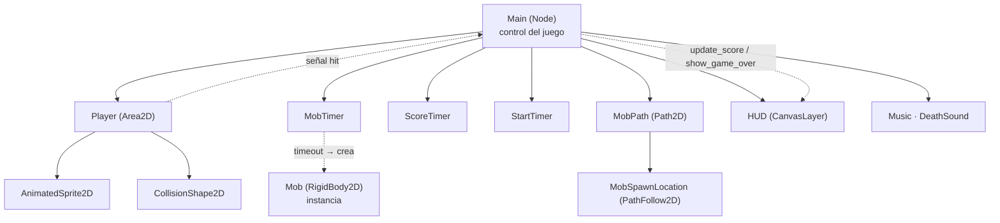

**Conclusión:** los dos juegos tienen los mismos bloques (control, jugador, enemigos, colisiones, interfaz, audio) y los organizan igual, como un **árbol de nodos que se comunican por mensajes**. La diferencia es que en Godot muchos bloques son **nodos ya hechos** que se configuran en el editor (temporizadores, caminos, notificadores de pantalla), mientras que en DiegoFo Engine se programan.

### Bloques funcionales de Órbita Zero

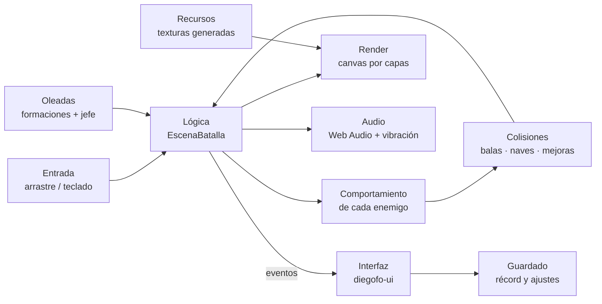

---

## f) Representación lógica y espacial de una escena

Una escena se puede describir de dos formas:
- **Lógica:** qué objetos hay y cómo se organizan (el árbol: quién contiene a quién).
- **Espacial:** dónde está cada objeto: coordenadas, capa, tamaño, caja de colisión y cómo se ve a través de la cámara.

### Representación lógica: el grafo de escena de Órbita Zero

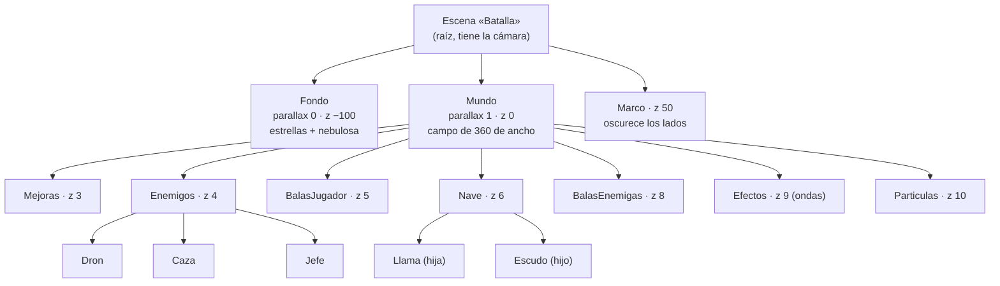

- **Los hijos heredan la transformación del padre:** la *Llama* y el *Escudo* son hijos de la *Nave*, y se mueven, se vuelven transparentes y parpadean con ella sin escribir código para seguirla.
- **Los grupos** (*Enemigos*, *BalasJugador*, *BalasEnemigas*…) permiten recorrer un tipo de objeto de una vez. Por ejemplo, las colisiones bala ↔ enemigo recorren solo esos dos grupos.
- **El orden de los grupos es el orden de dibujo:** las balas enemigas (z 8) se dibujan **encima** de las naves para que siempre se vean. Es una decisión de jugabilidad: lo que te mata tiene que verse.
- **Las etiquetas** (`"enemigo"`, `"balaEnemiga"`, `"mejora"`, `"jefe"`) dicen contra qué se comprueba cada choque.

### Los jefes: jerarquías dentro del árbol

Los dos jefes nuevos son el mejor ejemplo de por qué un motor usa un **grafo de escena**:

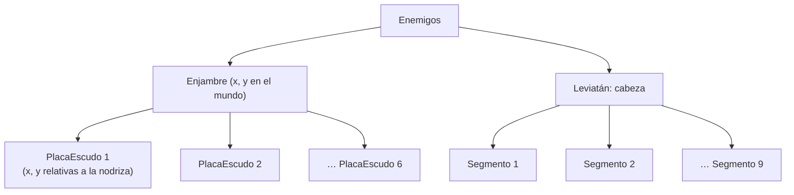

- **Enjambre:** cada placa solo sabe girar en círculo **alrededor de (0, 0)**, en coordenadas **locales**. Como es hija de la nodriza, el motor le suma la posición del padre y las placas la siguen solas cuando se mueve.
- **Leviatán:** la cabeza guarda un **rastro** de sus posiciones en el mundo y lo recorre midiendo la distancia para colocar un segmento cada 24 unidades. Cada segmento **convierte** esa posición del mundo a coordenadas locales (`rastro − cabeza`). Es el mismo cálculo que hace cualquier motor al pasar de un espacio a otro.
- **Buscar en el árbol:** las balas no comprueban solo los hijos directos del grupo *Enemigos*. Buscan con `buscarPorEtiqueta("enemigo")`, que **recorre todo el árbol**, así que encuentran también las placas y los segmentos.
- **Coordenadas globales:** al explotar un hijo, la explosión se coloca con `posicionGlobal()` y no con su `x, y` local.
- **Comunicación hijo → padre:** cuando un segmento recibe daño, avisa a su padre (`this.padre.recibirDano`), así que la barra de vida del Leviatán baja aunque dispares al cuerpo.
- **El árbol cambia sin parar:** en cada oleada se crean y destruyen decenas de nodos. En las pruebas automáticas, durante las oleadas normales, el árbol se mantuvo en **unos 30–40 nodos**.

### Representación espacial

**Tres sistemas de coordenadas:**

| Sistema | Unidad | Origen | Ejemplo |
|---|---|---|---|
| **Mundo** | Unidades del juego | Esquina superior izquierda del campo; *x* de 0 a 360, *y* hacia abajo | La nave en `(180, 520)` |
| **Cámara / vista** | Unidades | La cámara se coloca en `x = −(anchoVisible − 360) / 2` para centrar el campo | En un ordenador de 1280×720 se ven 1067 unidades de ancho y el campo queda en medio |
| **Pantalla** | Píxeles reales | Esquina del canvas | `unidades × escala × densidad` |

**Profundidad sin 3D:**
- **Capas (`z`):** fondo → mejoras → enemigos → balas propias → nave → balas enemigas → efectos → partículas → marco.
- **Parallax vertical:** el fondo tiene tres capas de estrellas que bajan a 14, 38 y 90 unidades/s, más una nebulosa a 10 unidades/s. Lo cercano va más rápido, así parece que la nave avanza por el espacio. Cuando llega el jefe, el fondo se acelera. Al cambiar de sector, dos nebulosas se mezclan durante 2,5 s (cada una con su opacidad).
- **Mezcla aditiva** (`"lighter"`): las balas, la llama y el escudo **suman** su color al de debajo, así brillan como luz.

**Cajas de colisión (AABB):** cada nodo tiene `ancho`, `alto`, un **ancla** (las naves tienen el origen en el centro, `{x: 0,5, y: 0,5}`) y un **margen** que encoge la caja. La nave del jugador se dibuja de 34 × 38 pero su caja es de solo **10 × 14**, como en los *bullet hell*: el juego perdona los roces y la sensación es justa.

### Verlo en el juego: el depurador (F2)

El modo depuración dibuja las dos representaciones encima del juego:
- **Lógica:** el árbol de la escena en vivo, con la posición global y la capa de cada nodo.
- **Espacial:** las cajas de colisión (verde para la nave, rojo para lo que tiene etiqueta) y una cruz amarilla en el origen de cada nodo. También muestra la cámara, el tamaño visible, la escala y la densidad.

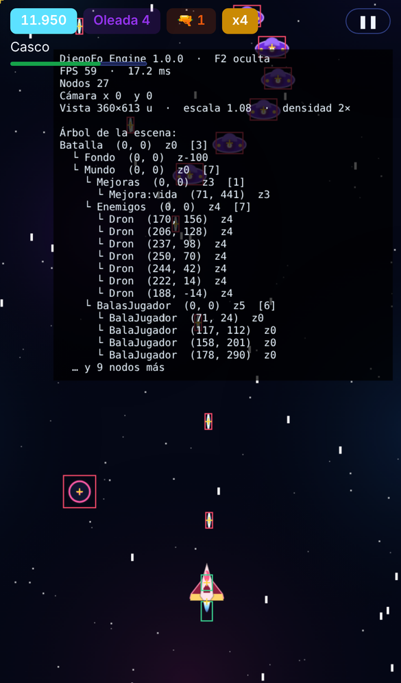

### La misma escena en distintos dispositivos

La escena lógica es **idéntica** en todos los dispositivos. Lo que cambia es la espacial: el campo siempre mide 360 de ancho, pero cambia cuánto se ve alrededor y a qué escala.

| Ordenador (1280×720) | Móvil en horizontal |
|:---:|:---:|
| 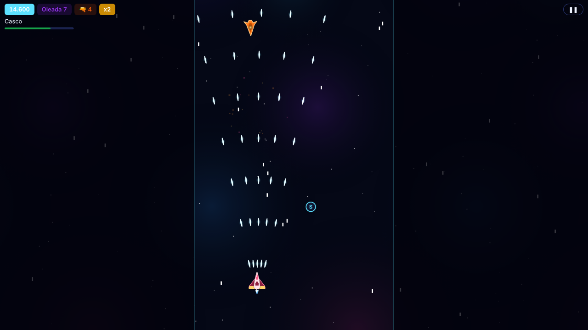 | 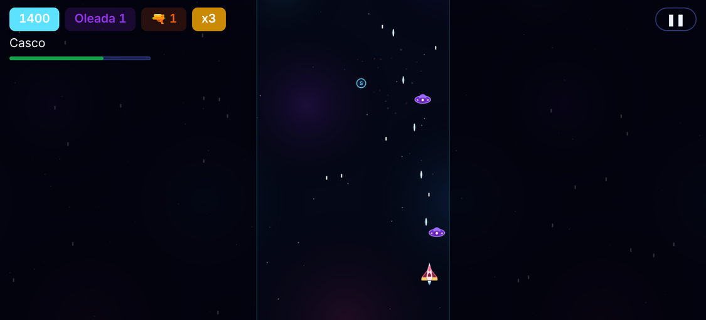 |

---

## Pruebas

Hay **34 comprobaciones automáticas** con Playwright (`pruebas/prueba-juego.js`). Todas pasan:

| Prueba | Resultado |
|---|---|
| Arrastrar el dedo en iPhone 14 (vertical y horizontal), Pixel 7 e iPad Mini emulados | ✅ La nave se mueve |
| Partida de 10 s con la nave invencible en los cuatro dispositivos | ✅ Sin errores de JavaScript; el árbol no pasa de 40 nodos |
| Saltar a la oleada 5 | ✅ Aparece el Acorazado con su barra de vida |
| Saltar a la oleada 10 | ✅ Aparece el Enjambre con sus 6 placas, y es invulnerable mientras las tiene |
| Saltar a la oleada 15 | ✅ Aparece el Leviatán con sus 9 segmentos |
| Llegar a la oleada 11 | ✅ Cambia al sector 3 |
| Ocultar la página (cambiar de app) | ✅ Se pausa sola y abre el diálogo de pausa |
| Primera vez que se abre | ✅ Pide crear un piloto y lo muestra en el menú |
| Terminar una partida | ✅ Da créditos y desbloquea «Primer vuelo» |
| Recargar la página | ✅ Se conservan el récord y el progreso |
| Comprar «Casco reforzado» en el hangar | ✅ La siguiente partida empieza con 4 de casco |
| Exportar, borrar el piloto e importar | ✅ Se recupera con sus mejoras |
| Importar un archivo que no es una copia de Órbita Zero | ✅ Se rechaza |

Además, probado a mano: pausa con `Esc` y con el botón, pinturas, logros, estadísticas, historial, ajustes, ayuda y la escena 3D.

```bash
cd pruebas
npm install
npx playwright install chromium
npm test
```

---

## Cómo hacer un juego con DiegoFo Engine

```html
<canvas id="juego"></canvas>
<script src="motor/nucleo.js"></script>
<!-- … resto de módulos en el orden de index.html … -->
<script src="motor/motor.js"></script>
<script>
  // 1. Un actor: un cuadrado que salta
  class Jugador extends DFE.Nodo {
    constructor() {
      super({ nombre: "Jugador", x: 100, ancho: 30, alto: 30, ancla: { x: 0.5, y: 1 }, fisica: true });
    }
    actualizar(dt) {
      const enSuelo = DFE.Fisica.apoyarEnSuelo(this, 250);
      if (enSuelo && this.escena.motor.entrada.seAcabaDePulsar("saltar")) this.velocidadY = -700;
    }
    dibujar(ctx) {
      ctx.fillStyle = "tomato";
      ctx.fillRect(-15, -30, 30, 30);
    }
  }

  // 2. El motor, los controles y la escena
  const motor = new DFE.Motor({ canvas: "#juego", anchoMinimo: 480, altoMinimo: 270 });
  motor.entrada.definir("saltar", ["Space", "toque"]);

  const escena = new DFE.Escena({ colorFondo: "#123" });
  escena.agregar(new Jugador());
  motor.iniciar(escena);
</script>
```

---

## Créditos

- Proyecto desarrollado en el ciclo **DAM**, módulos *Programación multimedia y dispositivos móviles* (análisis de motores de juegos, criterios a–f de este documento) y *Desarrollo de Interfaces* (librería diegofo-ui).

- **Motor, juego y librería diegofo-ui:** Diego Fernández Ortega.
- Todo el arte y el sonido se generan con código: no hay imágenes ni audios de terceros.
- **Claude** me ayudó a diseñar la arquitectura, escribir y explicar el código y redactar la documentación.
- Análisis de *Dodge the Creeps* a partir del tutorial "Tu primer juego 2D" de la documentación oficial de Godot y su proyecto de demostración.
